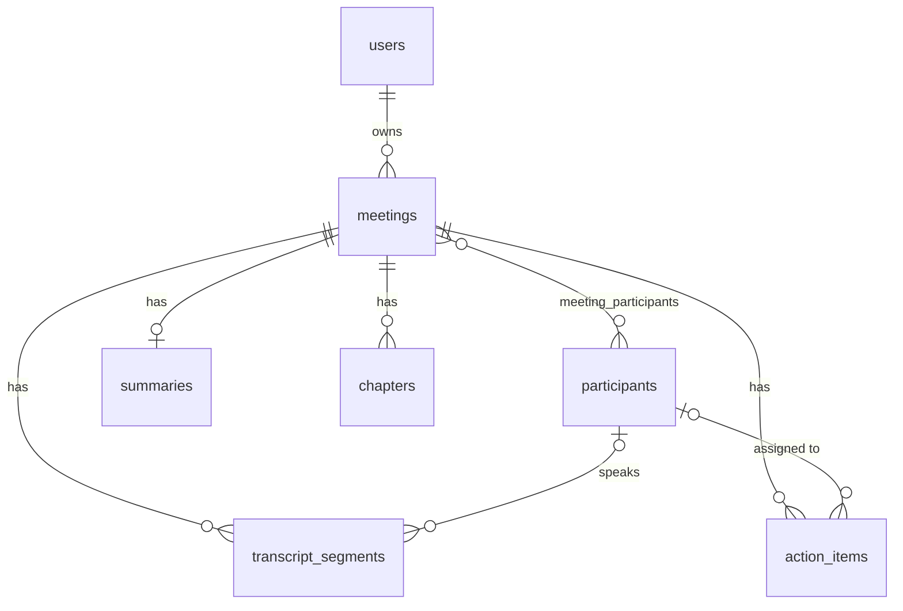

# Fireflies Clone: Meeting Notes & Transcription Platform

A Fireflies.ai-style workspace for browsing meetings, reading interactive transcripts, and working with summaries and action items. Built for the Scaler SDE Fullstack assignment.

Real speech-to-text and AI summarisation are out of scope, as the brief allows. Transcripts are pasted in, and summaries are seeded.

**Stack:** Next.js 16 (TypeScript, Tailwind CSS 4) · FastAPI · SQLAlchemy 2 · SQLite

## Features

**Meetings library**
- Meetings grouped by day, showing title, date, time, duration and participants
- Search by title or participant, filter by participant and date range, sort newest or oldest
- Pagination (10 per page), loading skeletons, empty and error states

**Meeting detail**
- Transcript with speaker avatars, labels and timestamps
- Simulated media player: play/pause, ±10 s, 1x / 1.5x / 2x, seek bar and a speaker talk-time strip
- Click a transcript line or topic to seek and play; the current line highlights as playback advances, and a "Follow" toggle keeps it in view
- Transcript search with highlighted matches, a match counter ("2 of 5") and next/previous navigation
- Tabs for the AI summary, topics/chapters and action items

**Meeting management**
- Create a meeting from a form, with an optional pasted transcript
- Edit a meeting's title and participants, and delete with a confirmation dialog
- Action items: add, edit (text, assignee, due date), complete/uncomplete and delete
- Every change is saved through the API and persists in SQLite

**Experience**
- Sidebar and top bar layout, modals, toasts, and loading, empty and error states
- Placeholders: Settings, Integrations (Zoom, Google Meet, Teams, Calendar, Slack, Salesforce), and sidebar items marked "Soon"

**Bonus features:** Export and Dark mode (see [Bonus features](#bonus-features)).

## Getting started

**Prerequisites:** Python 3.10+ (tested on 3.12) and Node.js 20.9+ (required by Next.js 16; tested on 22).

Run the backend and frontend in two terminals.

**1. Backend (http://localhost:8000)**

```bash
cd backend
python3 -m venv .venv
source .venv/bin/activate          # Windows: .venv\Scripts\activate
pip install -r requirements.txt
uvicorn app.main:app --reload --port 8000
```

On first start the app creates `backend/fireflies.db` and seeds demo data if there are no meetings yet.

**2. Frontend (http://localhost:3000)**

```bash
cd frontend
npm install
npm run dev
```

Open http://localhost:3000.

**Other commands**

| Task | Command |
|---|---|
| Interactive API docs | http://localhost:8000/docs |
| Reset the demo data | `cd backend && python -m app.seed.run_seed --reset` |
| Backend tests | `cd backend && pip install -r requirements-dev.txt && pytest` |
| Production frontend build | `cd frontend && npm run build && npm start` |

**Configuration (all optional)**

| Variable | Where | Default |
|---|---|---|
| `DATABASE_URL` | backend | SQLite file `backend/fireflies.db` |
| `CORS_ORIGINS` | backend | `http://localhost:3000,http://127.0.0.1:3000` |
| `SEED_ON_STARTUP` | backend | `true` |
| `DEFAULT_USER_NAME`, `DEFAULT_USER_EMAIL` | backend | `Alex Morgan`, `alex.morgan@example.com` |
| `BACKEND_URL` | frontend (set at build time) | `http://127.0.0.1:8000` |

Backend variables can go in `backend/.env` (see `.env.example`). The frontend variable can go in `frontend/.env.local` (see `.env.example`).

**Seed data:** 5 meetings (product roadmap, engineering standup, customer discovery call, campaign kickoff, design review) with 8 participants, 81 transcript segments, 26 chapters, 24 action items and a summary for each meeting. Meeting dates are set relative to the moment the database is first seeded.

## Architecture

```
Browser (Next.js app) ──/api/*, /media/*──▶ Next.js server ──rewrite──▶ FastAPI ──SQLAlchemy──▶ SQLite
```

The browser only talks to the Next.js server. `next.config.ts` rewrites `/api/*` and `/media/*` to the backend, so local development needs no CORS configuration. The backend also enables CORS for `CORS_ORIGINS` in case the frontend calls it directly.

### Backend (`backend/app`)

Requests flow through four layers:

| Layer | Folder | Responsibility |
|---|---|---|
| Routers | `routers/` | HTTP only: parse the request, call a service, return a response model |
| Services | `services/` | Business rules: filtering, creating meetings, transcript parsing, action-item validation |
| Schemas | `schemas/` | Pydantic request and response models |
| Models | `models/` | SQLAlchemy ORM tables |

Supporting pieces:
- `core/config.py`: settings (env vars and `.env`)
- `db/session.py`: engine, per-request session dependency, `PRAGMA foreign_keys=ON` for SQLite
- `dependencies.py`: the default logged-in user
- `seed/`: demo data and the `run_seed` CLI
- `tests/`: pytest suite

### Frontend (`frontend/src`)

| Folder | Contents |
|---|---|
| `app/` | Routes: `/meetings`, `/meetings/[id]`, `/settings`, `/integrations` (`/` redirects to `/meetings`) |
| `components/layout` | App shell, sidebar, top bar |
| `components/meetings` | Meeting row, filters, create/edit modal |
| `components/meeting-detail` | Player, transcript, notes tabs, action items, export menu |
| `components/ui` | Button, modal, confirm dialog, toast, dropdown, avatar, empty state |
| `hooks/` | `usePlayer` (simulated clock), `useDebounced`, `useTheme` |
| `lib/` | Typed API client, types, formatting, search, export, speaker colours |

Data is fetched with plain `fetch` in the pages. There is no state library: server responses are the source of truth, and the UI updates from what the API returns.

## Database schema

SQLite, created automatically with `Base.metadata.create_all` on startup.



| Table | Columns | Notes |
|---|---|---|
| `users` | `id`, `name`, `email` (unique), `avatar_url` | One seeded default user |
| `meetings` | `id`, `user_id` → users, `title`, `meeting_date`, `duration_seconds`, `media_url`, `source`, `created_at`, `updated_at` | `source` is `seed`, `paste` or `form`. Index on `(user_id, meeting_date)` |
| `participants` | `id`, `name` (indexed), `email` | Shared across meetings |
| `meeting_participants` | `meeting_id` → meetings, `participant_id` → participants | Many-to-many link, composite primary key |
| `transcript_segments` | `id`, `meeting_id` → meetings, `speaker_id` → participants, `position`, `start_ms`, `end_ms`, `text` | Index on `(meeting_id, position)` |
| `summaries` | `id`, `meeting_id` → meetings (unique), `overview`, `generated_by`, `generated_at` | One-to-one with a meeting |
| `chapters` | `id`, `meeting_id` → meetings, `title`, `description`, `start_ms`, `position` | Index on `(meeting_id, position)` |
| `action_items` | `id`, `meeting_id` → meetings, `assignee_id` → participants, `text`, `due_date`, `is_completed`, `created_at` | Index on `meeting_id` |

**Integrity rules**
- Deleting a meeting cascades to its links, segments, summary, chapters and action items (database `ON DELETE CASCADE`, backed by ORM cascades).
- Schema rule: if a participant row were deleted, `speaker_id` and `assignee_id` would be set to `NULL` rather than removing transcript lines or action items (the API has no participant-delete endpoint).
- An action item's assignee must be a participant of that meeting (enforced in the service layer).
- Removing a participant from a meeting clears their action-item assignments for that meeting.
- Timestamps inside a meeting are integer milliseconds. Datetimes are stored as UTC and returned with a `Z` suffix.

## API

All routes are under `/api`. Interactive docs are at `/docs`. Errors use FastAPI's `{"detail": ...}` shape: `404` for unknown ids, `422` for invalid input.

| Method | Path | Purpose |
|---|---|---|
| GET | `/health` | Health check (also verifies the database connection) |
| GET | `/me` | The default logged-in user |
| GET | `/participants` | People who appear in the user's meetings (feeds the filter dropdown) |
| GET | `/meetings` | List meetings with filters (below). Returns `{items, total, page, limit}` |
| POST | `/meetings` | Create a meeting (`201`) |
| GET | `/meetings/{id}` | Meeting metadata and participants |
| PATCH | `/meetings/{id}` | Edit `title` and/or `participants` |
| DELETE | `/meetings/{id}` | Delete the meeting and everything under it (`204`) |
| GET | `/meetings/{id}/transcript` | Ordered segments with speaker and `start_ms` / `end_ms` |
| GET | `/meetings/{id}/summary` | `overview` (or `null`), `generated_by`, `generated_at` and `chapters` |
| GET | `/meetings/{id}/action-items` | List action items |
| POST | `/meetings/{id}/action-items` | Add an action item (`201`) |
| PATCH | `/action-items/{id}` | Edit fields or set `is_completed` |
| DELETE | `/action-items/{id}` | Delete an action item (`204`) |
| GET | `/media/*` | Static files from `backend/media/` (not under `/api`; empty by default) |

**`GET /meetings` query parameters:** `q` (case-insensitive match on title or participant name), `participant_id`, `date_from` and `date_to` (`YYYY-MM-DD`, inclusive), `sort` (`newest` or `oldest`), `page` (from 1), `limit` (1 to 100, default 20; the UI uses 10).

**`POST /meetings` body:** `{ title, meeting_date?, duration_seconds?, participants?: string[], transcript_text? }`. The date defaults to now. If a transcript is supplied, anyone who speaks is added as a participant and the duration is at least the transcript's length.

**Pasted transcript format:** one speaker turn per line, with an optional `[MM:SS]` (or `[H:MM:SS]`) timestamp.

```
[00:05] Priya Sharma: Okay, let's get started.
[00:41] Arjun Mehta: Here's the shortlist.
```

Lines without a timestamp get an estimated one. A line that isn't `Speaker: text` continues the previous turn, and a transcript that doesn't start with a `Speaker: text` line is rejected with a `422`.

**`PATCH /action-items/{id}`:** only the fields sent are changed. Sending `assignee_id: null` or `due_date: null` clears them, while `text` and `is_completed` cannot be null.

## Key decisions and trade-offs

- **Layered backend.** Routers stay thin and rules live in services, which keeps the API easy to read and test.
- **Participants are a shared table.** Speakers, meeting attendees and action-item assignees all reference the same rows, so filtering by person works across meetings. The trade-off is that people are matched by name (case-insensitive), so two different people with the same name are treated as one, and renaming one person is not supported.
- **Millisecond integers for transcript times.** This makes seeking and "which line is active" simple comparisons, with no floating-point drift.
- **Transcript search runs in the browser.** The transcript is already loaded, so matching, counting and highlighting are instant. Library search is server-side.
- **Simulated player.** There is no audio. A 100 ms clock runs over the meeting's duration, and the transcript, topics and talk-time strip all react to it. The hook is self-contained, so a real audio element could replace it.
- **Server responses drive the UI.** Writes wait for the API and then update the list from the response, rather than updating optimistically. This is a little less snappy but avoids showing state that was never saved.
- **Proxy instead of CORS.** Same-origin requests through Next.js rewrites keep local setup to two commands.
- **Plain `fetch` and hooks.** No data-fetching library, to keep the dependency surface small for a project of this size.
- **`create_all` instead of migrations.** Fine for a single-schema SQLite demo, but a real deployment would add Alembic.
- **Theme via design tokens.** See [Dark mode](#dark-mode).

## Assumptions and limitations

- **Single default user.** There is no authentication. All requests are treated as coming from one seeded user.
- **Transcripts come from pasted text or the form.** Uploading `.txt`, `.vtt` or `.json` files is not implemented.
- **Summaries are seeded only.** There is no summary generation or LLM call. A meeting created in the app has no summary or topics, and the UI shows an empty state.
- **Create-time fields.** A meeting's date, duration and transcript are set when it is created and cannot be edited later. Only the title and participants are editable.
- **No real media.** `media_url` is unused and `backend/media/` is empty.
- **Times** display in the browser's local timezone.
- **Not implemented** (placeholders only): live meeting bot, speech-to-text, integrations, team sharing and real sign-in.
- **Deployment** is not part of this repository. When deploying separately, set `BACKEND_URL` when building the frontend, and set `CORS_ORIGINS` and `DATABASE_URL` for the backend.

## Bonus features

### Export

An **Export** menu in the meeting header. Files are generated in the browser from the data already on the page, with no extra API calls.

- **Transcript** downloads `<title-slug>-transcript.txt`: a short header (title, date, duration, participants), then one `[mm:ss] Speaker: text` line per turn.
- **Summary and notes** downloads `<title-slug>-notes.md`: title and meeting details, the summary, the topics with timestamps, and action items as a checklist (`- [x]` / `- [ ]`) with assignee and due date.
- Each option is disabled when there is nothing to export.

### Dark mode

A moon/sun toggle in the top bar, plus a Light/Dark control on the Settings page.

- The preference is saved in `localStorage`. Light is the default, and dark applies only if the user has chosen it. A small inline script applies the saved choice before first paint, so there is no flash of light theme.
- Colours are defined as CSS variables (design tokens), and dark mode re-points them under `html.dark`, so every screen follows without per-component dark styles.
- Dark colour pairs were checked for text contrast.

## Testing

| What | Details |
|---|---|
| Backend tests | `cd backend && pytest`: 18 tests against an isolated temporary database. They cover health, listing, sorting, search, participant and date filters, pagination, create (form and pasted transcript), invalid input, update, delete cascade, transcript, summary, action-item CRUD, the assignee rule and participant removal |
| Type check and build | `npx tsc --noEmit` and `npm run build` pass with no errors |
| UI smoke tests | During development, 12 UI tests ran in a simulated browser (jsdom) against the live frontend and backend. They covered library search, filter, sort, create, edit and delete; seeking, the active line and transcript search on the detail page; topics; action-item CRUD; export file contents; and the dark-mode toggle. Where the tests checked persistence, they re-read the data from the API. These tests are not included in the repository |
| Manual testing | The application was exercised in a real browser |

There are no automated end-to-end browser tests, and the visual match to Fireflies was judged by eye, not by automated comparison.

## AI tools used

This project was built with **Claude (Anthropic)** & **ChatGPT**, which assisted with architecture, schema design, backend and frontend implementation, tests and this documentation.
